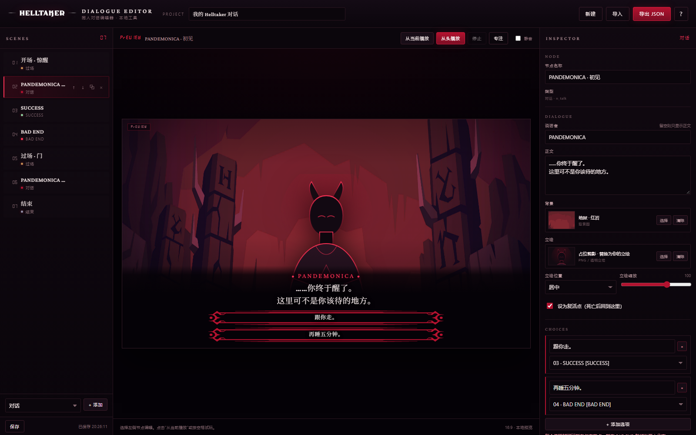

# HELLTAKER · Dialogue Editor

本地同人对话 / 剧情过场编辑器。  
只做 Helltaker 风格的 **对话、选项、剧情过场、BAD END、SUCCESS、结束卡**，不包含原版关卡玩法。

> 术语区分：**转场动画** = 原版石门 / HELLTAKER 标志的开合动画；**剧情过场** = 带插图 + 旁白的 cutscene 节点。



---

## 1. 快速开始

双击 `start.bat`。它会启动本地服务器并打开浏览器。

或者在本目录运行：

```bat
python -m http.server 8765 --bind 127.0.0.1
```

然后打开：

```text
http://127.0.0.1:8765/
```

> 如果 8765 被占用，换一个端口即可，例如 `python -m http.server 8766`。
> 不要直接双击 `index.html` 也可以运行，但本地服务器更稳定（字体、音频、上传素材都不容易遇到浏览器限制）。
> 关闭服务器：关掉最小化的 “Helltaker Editor Server” 命令行窗口即可。

---

## 2. 这个编辑器能做什么

节点类型：

| 类型 | 用途 |
| --- | --- |
| 对话 `dialogue` | 背景 + 立绘 + 说话者 + 正文 + 最多 4 个选项；可设为复活点 |
| 剧情过场 `cutscene` | 全屏画面 + 旁白 + 红眼点击指示器；对应开场 / 通用剧情画面 |
| 标题卡 `title` | HELLTAKER 标志 / 标题 + 副标题 + 开始按钮 |
| SUCCESS | 背景 / 立绘与对话节点使用完全相同的参数（立绘可调位置/缩放）；留言默认沿用上一个对话，可在右侧改；下方播放 SUCCESS / GLORIOUS SUCCESS 动画，结束后点击舞台 / 空格继续 |
| BAD END | BAD END 帧动画；默认回到最近一次经过的对话，也可以指定固定节点 |
| 结束 `end` | 结束卡 + 重新开始 / 返回编辑 |

完整流程示例（默认项目）：

```text
开场剧情过场 → 对话（复活点）→ 选项
                         ├─ 正确 → 转场动画 → SUCCESS → 转场动画 → 剧情过场 → 对话 → 结束
                         └─ 错误 → BAD END → 转场动画 → 回到上次对话
```

操作：

- 左侧 **SCENES**：添加、复制、上移 / 下移、删除节点。
- 中间 **PREVIEW**：选中节点即时预览。
- 右侧 **INSPECTOR**：改文字、素材、选项、跳转目标。
- **从当前播放**：从选中节点开始试玩。
- **从头播放**：从第一个节点开始。
- **专注**：隐藏两侧面板，放大预览。
- **游戏内音频**：播放时舞台右上角会出现「音乐」「音效」两个按钮，默认关闭。音乐固定使用 `assets/audio/Vitality.mp3`，音效控制对话 / 选项 / 转场等所有游戏音效。
- **保存**：自动保存到浏览器 localStorage；也可以手动保存。
- **导出 JSON**：完整项目（含上传素材）下载备份。
- **导入**：读取之前导出的 JSON。
- **换素材**：右侧「背景 / 立绘 / 画面 → 选择」，或直接点预览里的背景 / 立绘 / 剧情图。
  注意：剧情过场节点只有「画面」；SUCCESS 节点和对话节点一样有「背景 + 立绘」，并自动沿用上一个对话的留言。
- **SUCCESS 留言同步**：右侧有「沿用上一个对话（背景 / 立绘 / 留言）」按钮，改完上一个对话后可以一键同步。

快捷键：

- `空格 / Enter`：试玩时推进文本
- `Esc`：停止试玩 / 关闭弹窗
- `Ctrl + S`：立即保存

---

## 3. 素材清单与来源

素材在 `assets/ui/`，完整来源清单见 `assets/manifest.json`。  
原始解包文件仍在：

```text
D:\steam\steamapps\common\Helltaker\Helltaker_unpacked
```

### 3.1 对话界面

| 文件 | 来源 / 说明 |
| --- | --- |
| `dialogue-bg-hell.png` | `dialogueBG_hell`，1960×544 红岩地狱背景 |
| `dialogue-bg-abyss.png` | `dialogueBG_abyss` |
| `dialogue-bg-sin.png` | `dialogueBG_sin` |
| `dialogue-bg-home.png` | `dialogueBG_home` |
| `dialogue-bg-throne.png` | `dialogueBG_throne2` |
| `choice-frame.png` | `button0004` 重新着色为深红，用作未选中态 |
| `choice-frame-hover.png` | `button0003` 重新着色为亮红，用作选中 / 悬停态 |
| `choice-frame-white.png` | `button0003` 原始白色版本 |
| `small-frame.png` | `button_small` 重新着色 |
| `chapter-line.png` | `W_chapterSelect` 重新着色，装饰线备用 |
| `portrait-placeholder.svg` | 自制占位剪影，不是游戏素材 |

### 3.2 点击指示器 / 动画

| 文件 | 来源 / 说明 |
| --- | --- |
| `booper/booper-01..17.png` | `booper0001..0017` 红眼指示器，已重新着色为红色；只保留 24fps 循环的 idle 动画。点击反馈已移除，18–28 点击帧已从素材中删除 |
| `booper.png` | 指示器静止帧（第 8 帧），可直接当单张素材用 |
| `success/success-01..16.png` | `success0001..0016`。01–08 为 `SUCCESS`，09–16 为 `GLORIOUS SUCCESS`；已去除黑底，保留透明 |
| `success.png` / `success-glorious.png` | 两种 SUCCESS 的最终静止帧，可直接当单张素材用 |
| `badend/badend-01..09.png` | `dialogueDeathExport0001..0009` BAD END 出现动画；已去除黑底 |
| `badend.png` | BAD END 最终静止帧 |

### 3.3 剧情图 / 标题

| 文件 | 来源 / 说明 |
| --- | --- |
| `cutscene/cutscene-0000..0008.png` | `cutscene_0000..0008` 共 9 张剧情图；`0002` 是开场惊醒，`0003` 是镜子 |
| `chapter-bg-01..08.png` | `chapterBG0001..0008`，可作为标题卡 / 章节背景 |
| `helltaker-logo.png` | 从你提供的标题画面截图提取的 HELLTAKER 字标，已去除红底 |

### 3.4 转场动画

| 文件 | 来源 / 说明 |
| --- | --- |
| `transition/transition-0002..0030.png` | `transition0002..0030` 的原版 HELLTAKER 石门开合动画。`transition_close` 用 02–21，`transition_open` 用 22–30 |
| `transition/runtime/` | 960px 宽、预加载的运行时副本；播放速度 **30fps**，整套约 0.97 秒 |
| 场景切换点 | 到 `transition-0006`（完整石门）时先把下一幕换到遮罩下面，再继续关门/开门，结束时平滑露出新场景 |
| 黑底处理 | 原帧自带黑底，运行时用 `mix-blend-mode: screen` 把黑色视为透明，让当前/下一场景从石门周围透出 |
| 自动播放位置 | 开场剧情过场 → 首段对话；BAD END → 回到上次对话 / 从头开始；SUCCESS → 下一个场景 |

### 3.5 字体与音效

| 文件 | 来源 |
| --- | --- |
| `fonts/CrimsonPro-Medium.ttf` | 游戏内嵌字体 |
| `fonts/Amiri-Regular.ttf` | 游戏内嵌字体 |
| `fonts/Segment7Standard.ttf` | 游戏内嵌字体（数字） |
| `audio/dialogue-start.wav` | `dialogue_start_01.wav`；只在一段对话的第一句播放 |
| `audio/text-end.wav` | `dialogue_text_end_01.wav`；每句打字完成时播放 |
| `audio/choice-move.wav` | `button_dialogue_highlight_01.wav` |
| `audio/choice-confirm.wav` | `button_dialogue_confirm_01.wav` |
| `audio/success.wav` | `dialogue_success_01.wav` |
| `audio/badend.wav` | `bad_end_screen_01.wav` |
| `audio/transition-close.wav` / `transition-open.wav` | `screen_changer_part1_01.wav` / `screen_changer_part2_01.wav`；转场的分层音轨，同时开始 |

### 3.6 音效安排

- 进入一段对话：只播一次 `dialogue-start`，不再每句重放。
- 每句文字打完：播 `text-end`（短提示音）。
- 选项悬停 / 确认：分别播 `choice-move` / `choice-confirm`。
- 转场：`transition-close` + `transition-open` 两条分层音轨同时开始。
- BAD END / SUCCESS：各自的主题音效。

### 3.7 没有包含的内容

- 角色立绘：请在编辑器里上传你自己的透明 PNG。内置只有占位剪影。
- BGM：没有打包原曲；需要的话你可以自己上传 / 外部播放。
- 原版关卡、推箱子、敌人、UI 之外的玩法内容：没有包含。
- 图 2 的恶魔门 3D 背景：它不是单独一张 2D 贴图，所以没有强行抠图；标题卡默认使用章节背景，你可以换成自己的图。

---

## 4. 上传立绘 / 背景

1. 选中一个对话或剧情过场节点。
2. 在右侧找到「立绘」或「背景」。
3. 点「选择」→「上传图片」。
4. 建议立绘：透明 PNG，高度 800–1200px；单张不超过 2MB。
5. 上传素材会写入项目 JSON，所以**导出 JSON 备份时会一起带走**。

如果浏览器提示本地存储已满，先点「导出 JSON」，再到新项目里导入。

---

## 5. 目录结构

```text
helltaker对话编辑器/
├─ index.html
├─ style.css
├─ app.js
├─ start.bat
├─ README.md
├─ NOTICE.md
├─ preview.png
└─ assets/
   ├─ manifest.json
   ├─ ui/
   │  ├─ dialogue-bg-*.png
   │  ├─ chapter-bg-*.png
   │  ├─ choice-frame*.png
   │  ├─ small-frame.png
   │  ├─ chapter-line.png
   │  ├─ portrait-placeholder.svg
   │  ├─ helltaker-logo.png
   │  ├─ booper/
   │  ├─ success/
   │  ├─ badend/
   │  ├─ cutscene/
   │  └─ transition/
   │     └─ runtime/
   ├─ fonts/
   └─ audio/
```

---

## 6. 版权 / 素材声明

本项目是**个人学习用途**的本地同人工具，不用于商业用途。

- 内置的游戏 UI、剧情图、转场动画、字体和音效，版权归 **vanripper / Helltaker 原作** 所有，仅作技术学习示例保留。
- `index.html` / `style.css` / `app.js` 为本项目自写代码，可自由阅读参考。
- **如版权方或任何作者不希望这些素材出现在这里，请开 Issue 说明文件，我会立即删除对应内容。**
- 请不要把 `assets/` 当作免费素材包转载或二次分发。

完整声明见 [NOTICE.md](NOTICE.md)。

> 仅供学习交流 · 如有侵权请联系删除
